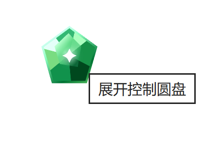
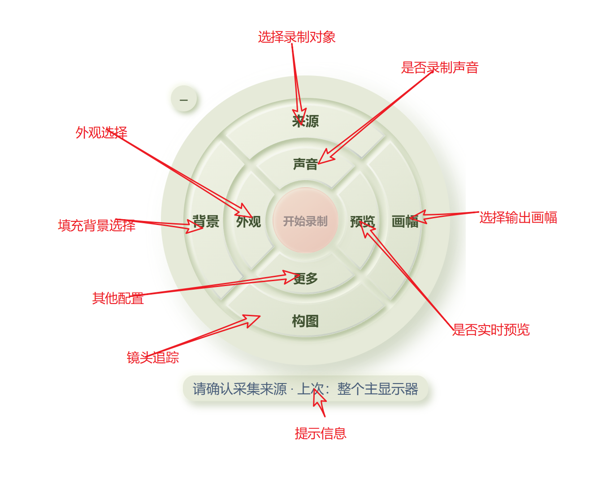
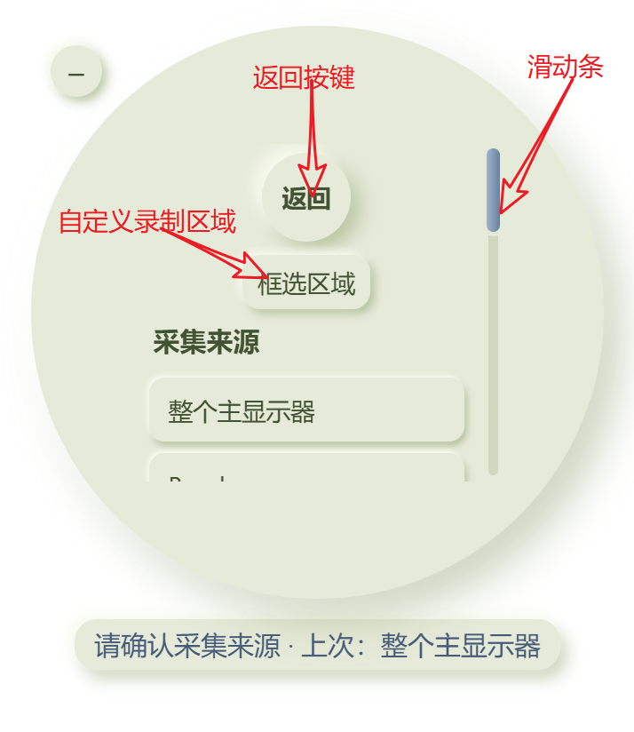
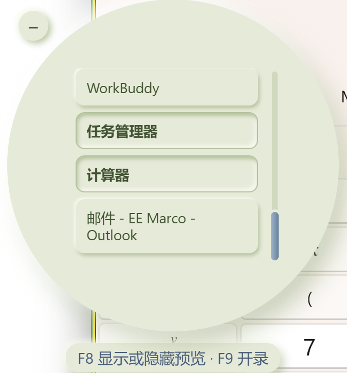
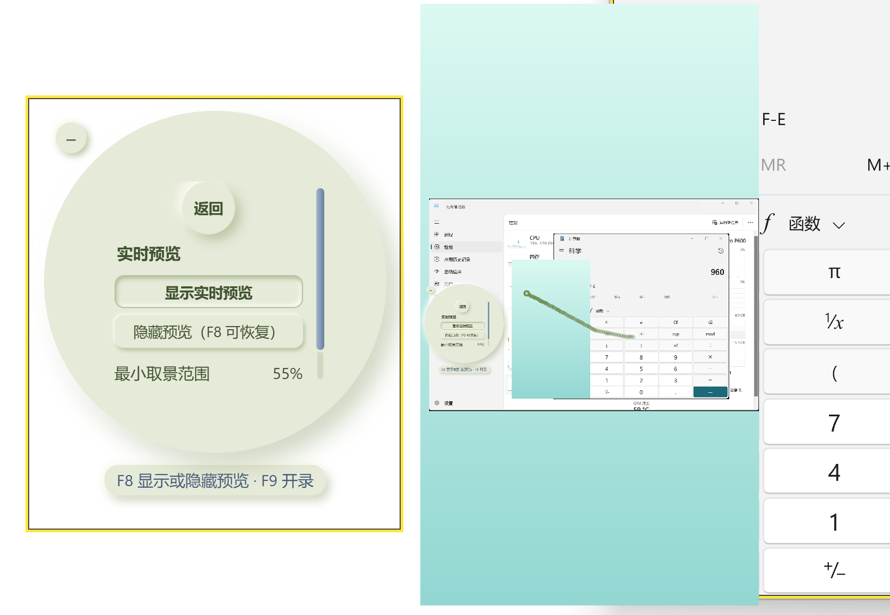
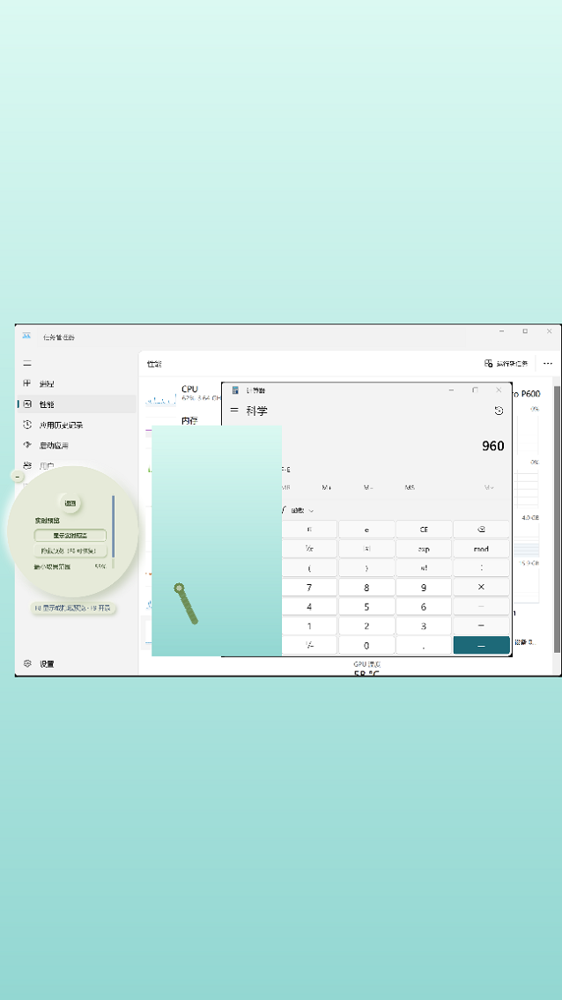
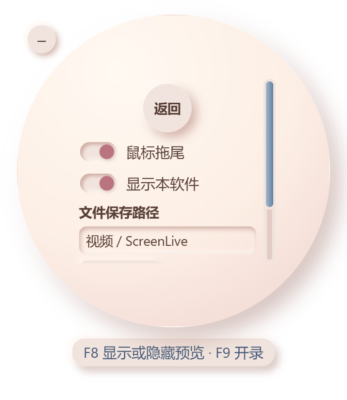

# ScreenLive

English · [简体中文](README.zh-CN.md)

ScreenLive is a Windows screen recorder with portrait and landscape output, mouse-follow framing, a borderless live preview, and system and microphone audio.

**[Download ScreenLive for Windows x64](https://github.com/HookyMaster/screenlive/releases/latest/download/ScreenLive-Windows-x64.zip)** · [Release notes and checksums](https://github.com/HookyMaster/screenlive/releases/latest)

## Install and launch

1. Download and extract the entire ZIP. ScreenLive requires 64-bit Windows 10 22H2 or Windows 11 and the [Microsoft Edge WebView2 Runtime](https://developer.microsoft.com/microsoft-edge/webview2/).
2. Download the Essentials ZIP from [FFmpeg Windows builds](https://www.gyan.dev/ffmpeg/builds/). Copy its `bin/ffmpeg.exe` into the extracted ScreenLive folder, alongside `ScreenLive.exe`. FFmpeg is a separate download.
3. Double-click `ScreenLive.exe`. Keep the recorder component and WebView2 loader in the same folder.

## Interface language

Open **更多 (More) → 语言 (Language) → English** to switch the interface immediately. To switch back, select **More → Language → Simplified Chinese**. ScreenLive remembers your choice after restart.

The v0.2.1 Windows download includes the language switch and layout fixes for English labels. The walkthrough screenshots show the Chinese interface.

## Screenshot walkthrough

### 1. Right-click to exit

Right-click the gem and choose Exit to close ScreenLive.


### 2. Expand the dial

Left-click the gem to open the control dial.



### 3. Collapse the dial

Click the collapse button at the upper left to return to the gem.


### 4. Dial controls

The center button starts or stops recording. The surrounding buttons open settings.



### 5. Navigate the submenus

Choose an option in the submenu and use Back to return to the dial.



### 6. Select capture sources

Select one or more windows, the primary display, or a custom region. When a region and windows are both selected, only the selected windows within the region are captured.



### 7. Show the live preview

Turn on the live preview to check the framing before recording. Drag the window to move it, or resize it by dragging an edge.



### 8. Avoid recursive preview

When ScreenLive is included in the recording, its preview area uses a background placeholder to avoid a feedback loop.



### 9. Adjust minimum framing

Use the Preview menu to adjust the tightest framing in mouse-follow mode.


### 10. Choose an appearance

Change the dial theme in Appearance. The pointer marker and trail follow the selected colors.


### 11. Choose a fill background

Select a background for areas left empty by the framing or capture sources.


### 12. Open more settings

Set the save folder, enable the mouse trail, or include ScreenLive in the capture.



### 13. Choose an output aspect ratio

Choose the aspect ratio for the destination. The default is 9:16 at 1080 × 1920 and 30 fps.


### 14. Mix system and microphone audio

Choose the playback and microphone devices separately, then check their live levels.


## Start and stop recording

Click the center of the dial or press F9 to start or stop recording. Press F8 to hide or restore the live preview. Files are saved to Videos / ScreenLive by default.

## Build from source

On Windows, use Rust and a compatible Windows C/C++ toolchain.

```powershell
cargo build --locked --release --manifest-path desktop-app/Cargo.toml
cargo build --locked --release --manifest-path platform/windows/Cargo.toml --example record
```

Rename `screenlive-desktop.exe` to `ScreenLive.exe` and `record.exe` to `record-backgrounds.exe`. Place them alongside the x64 `WebView2Loader.dll` and `ffmpeg.exe`. The loader comes from the [Microsoft WebView2 SDK](https://learn.microsoft.com/microsoft-edge/webview2/concepts/distribution#files-to-ship-with-the-app).

- `desktop/` contains the control dial and menus.
- `desktop-app/` contains the Tauri application and settings.
- `core/` contains the framing and mouse-follow logic.
- `platform/windows/` contains Windows capture, preview, and recording.

## License

ScreenLive v0.2.0 and later are available for noncommercial use under the [ScreenLive license](LICENSE). Commercial use requires prior written permission from HookyMaster. The previously published v0.1.0 remains under its [original MIT license](docs/LICENSE-v0.1.0-MIT.txt). See [third-party notices](THIRD-PARTY-NOTICES.md) for dependency licenses.
