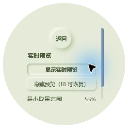

# ScreenLive

ScreenLive 是一款 Windows 屏幕录制工具，支持竖屏和常用横屏画幅、鼠标跟随镜头、无边框实时预览，以及电脑声音和麦克风录制。

**[下载 Windows x64 便携版](https://github.com/HookyMaster/screenlive/releases/latest/download/ScreenLive-Windows-x64.zip)** · [查看 Release](https://github.com/HookyMaster/screenlive/releases/latest)

## 安装与首次启动

1. 下载 ZIP 并完整解压。系统需要 Windows 10 22H2 或 Windows 11（64 位）及 [Microsoft Edge WebView2 Runtime](https://developer.microsoft.com/microsoft-edge/webview2/)。
2. 打开 [FFmpeg Windows x64 builds](https://www.gyan.dev/ffmpeg/builds/)，下载 Release builds 下的 Essentials ZIP。把其中 `bin/ffmpeg.exe` 放到 ScreenLive 解压目录，与 `ScreenLive.exe` 同级。FFmpeg 单独提供。
3. 双击 `ScreenLive.exe`。主程序、采集组件和 WebView2 加载器应保留在同一目录。

## 截图教程

### 1. 在圆盘选来源


打开「来源」，选择一个或多个应用窗口、整个主显示器，或拖动鼠标「框选区域」。同时选择窗口和框选区域时，只录入已选窗口落在框内的部分。按 Esc 或右键可取消框选。

### 2. 设置画幅、预览和声音



在「画幅」选择输出比例，默认是 9:16、1080 × 1920、30 fps。在「预览」打开实时画面并调整最小取景范围。预览窗口可拖动，拉伸边缘会等比缩放并记住大小。F8 可隐藏或恢复预览。

在「声音」分别选播放设备和麦克风，根据实时电平确认输入。在「更多」可以打开鼠标拖尾、选择是否显示本软件并修改保存路径。

### 3. 开始录制和保存

点击圆盘中央开始录制。圆盘收成宝石后，点击宝石可展开并结束录制。也可按 F9 开始或停止。保存进度在圆盘外沿显示。默认文件夹为「视频 / ScreenLive」。

## 从源码构建

在 Windows 上使用 Rust 和兼容的 Windows C/C++ 构建工具：

```powershell
cargo build --locked --release --manifest-path desktop-app/Cargo.toml
cargo build --locked --release --manifest-path platform/windows/Cargo.toml --example record
```

将生成的 `screenlive-desktop.exe` 改名为 `ScreenLive.exe`，将 `record.exe` 改名为 `record-backgrounds.exe`，并与 x64 的 `WebView2Loader.dll`、`ffmpeg.exe` 放在同一目录。加载器来自 [Microsoft WebView2 SDK](https://learn.microsoft.com/microsoft-edge/webview2/concepts/distribution#files-to-ship-with-the-app)。

- `desktop/` 控制圆盘和菜单
- `desktop-app/` Tauri 应用与设置
- `core/` 取景、镜头跟随和构图
- `platform/windows/` Windows 采集、预览和录制

## 许可证

自 v0.2.0 起，ScreenLive 仅允许非商业使用。商业使用须事先取得 HookyMaster 的书面授权。完整条款见 [LICENSE](LICENSE)。此前按 MIT 发布的 v0.1.0 仍适用 [当时的许可证](docs/LICENSE-v0.1.0-MIT.txt)。第三方组件各自适用原许可，见 [第三方组件说明](THIRD-PARTY-NOTICES.md)。
