# ScreenLive

[English](README.md) · 简体中文

ScreenLive 是一款 Windows 屏幕录制工具，支持竖屏和常用横屏画幅、鼠标跟随镜头、无边框实时预览，以及电脑声音和麦克风录制。

**[下载 Windows x64 便携版](https://github.com/HookyMaster/screenlive/releases/latest/download/ScreenLive-Windows-x64.zip)** · [查看 Release](https://github.com/HookyMaster/screenlive/releases/latest)

## 安装与首次启动

1. 下载 ZIP 并完整解压。系统需要 Windows 10 22H2 或 Windows 11（64 位）及 [Microsoft Edge WebView2 Runtime](https://developer.microsoft.com/microsoft-edge/webview2/)。
2. 打开 [FFmpeg Windows x64 builds](https://www.gyan.dev/ffmpeg/builds/)，下载 Release builds 下的 Essentials ZIP。把其中 `bin/ffmpeg.exe` 放到 ScreenLive 解压目录，与 `ScreenLive.exe` 同级。FFmpeg 单独提供。
3. 双击 `ScreenLive.exe`。主程序、采集组件和 WebView2 加载器应保留在同一目录。

## 截图教程

### 1. 右键退出

右键点击宝石，选择「退出」关闭 ScreenLive。


### 2. 展开圆盘

左键点击宝石，展开控制圆盘。


### 3. 收起圆盘

左键点击圆盘左上角的收起按钮，回到宝石状态。

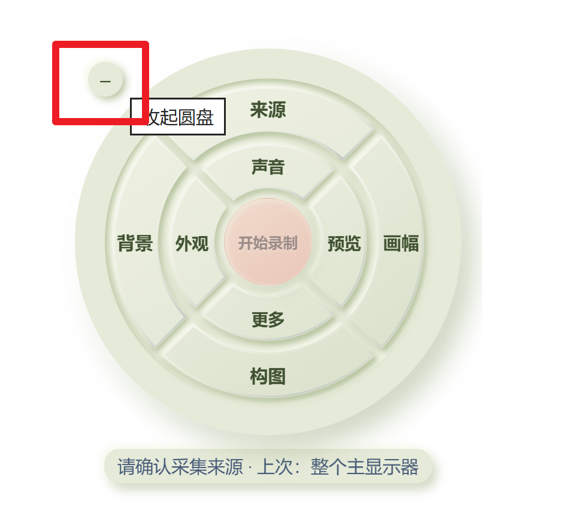

### 4. 圆盘按键

中央按钮开始或结束录制，周围的按钮打开对应设置。

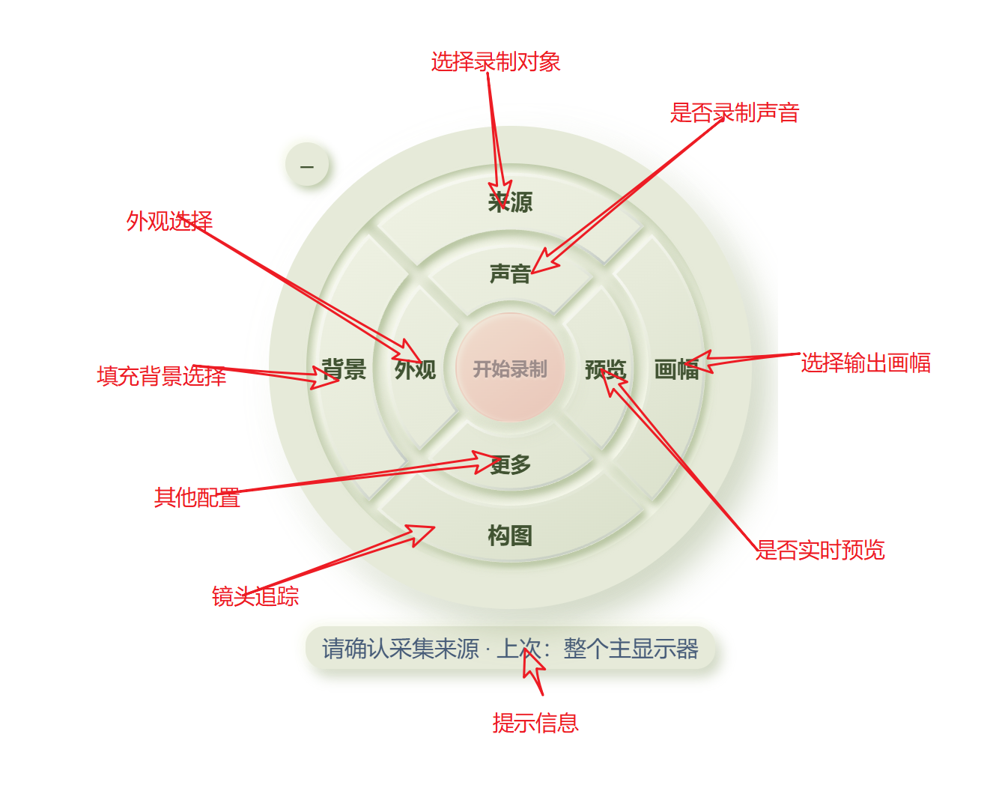

### 5. 子菜单操作

在子菜单中选择选项，再点击「返回」回到圆盘。

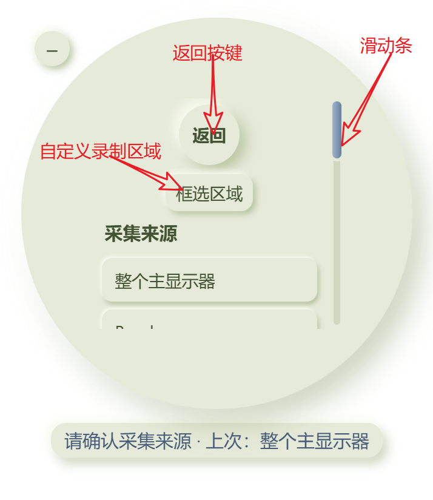

### 6. 选择采集来源

可选择一个或多个窗口、整个主显示器或自定义区域。同时选择窗口和区域时，只采集已选窗口落在框内的部分。

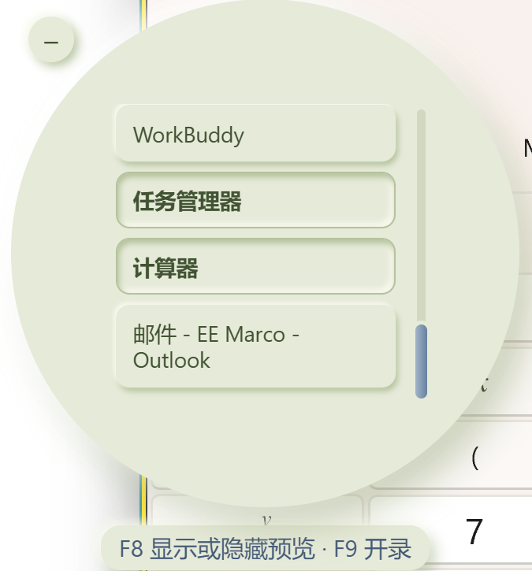

### 7. 显示实时预览

开始录制前，可打开实时预览检查构图。拖动窗口可移动，拉伸边缘可等比调整大小。

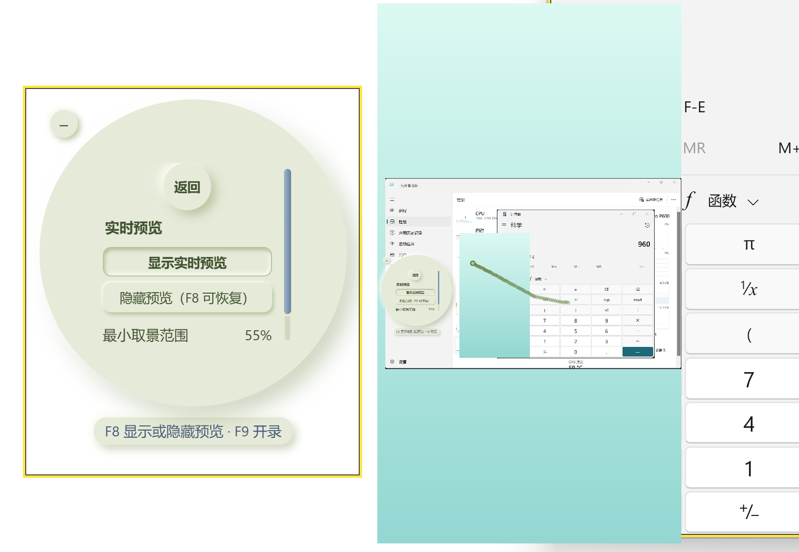

### 8. 避免预览递归

开启「显示本软件」时，预览窗口区域使用背景占位，避免画面层层嵌套。

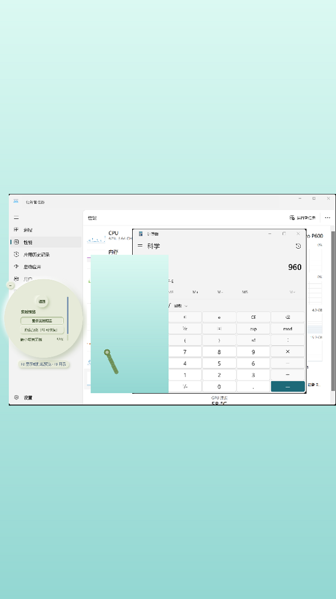

### 9. 设置最小取景范围

在「预览」菜单调整镜头跟随时的最小取景范围。

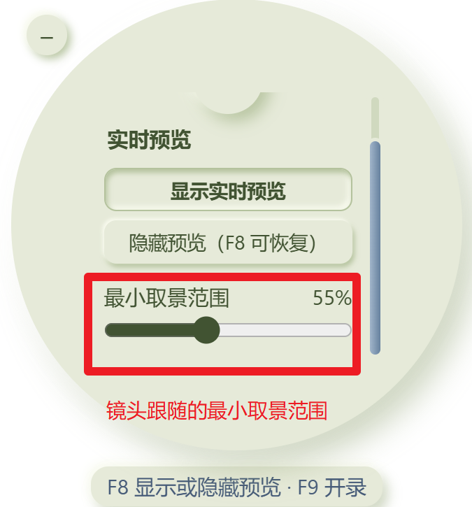

### 10. 选择外观

在「外观」更换圆盘主题，鼠标标记和拖尾会随主题换色。

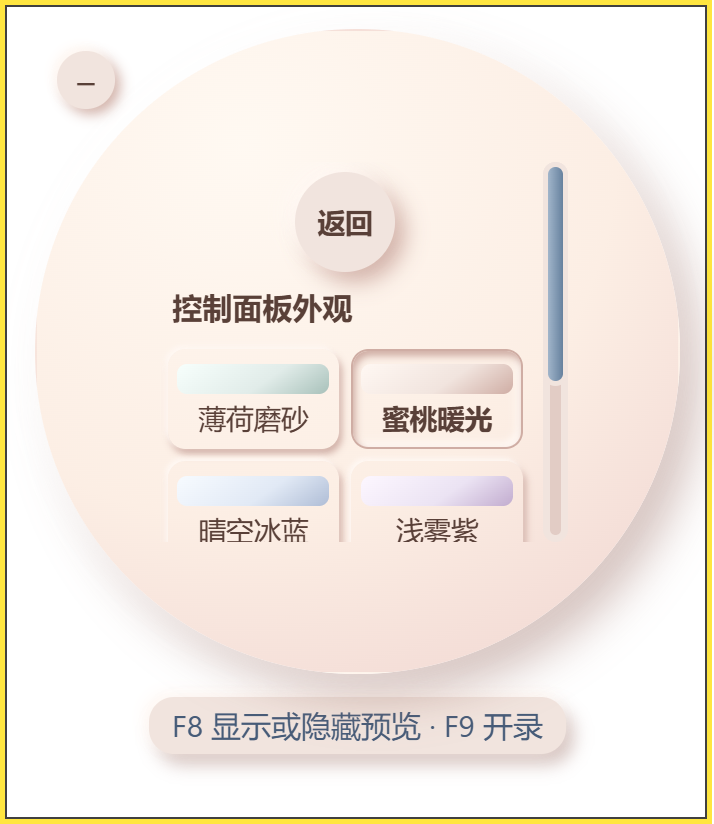

### 11. 选择填充背景

为取景或采集来源留下的空白区域选择填充背景。

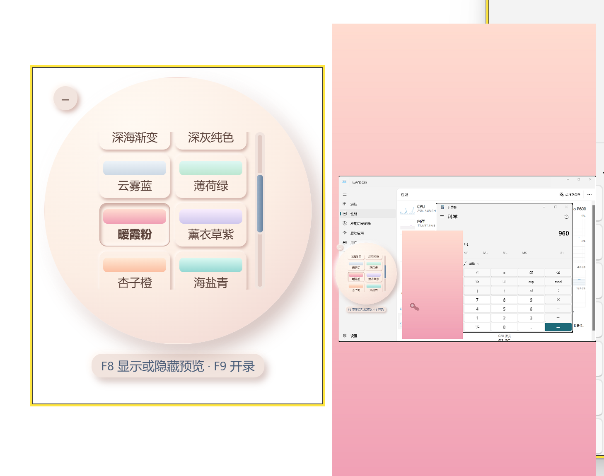

### 12. 打开更多设置

设置保存路径、开启鼠标拖尾，或让本软件出现在采集画面中。

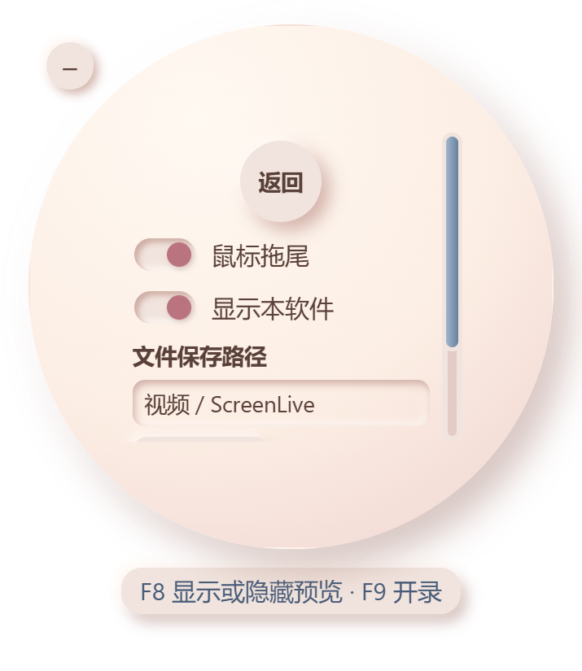

### 13. 选择输出画幅

按用途选择输出画幅。默认是 9:16、1080 × 1920、30 fps。

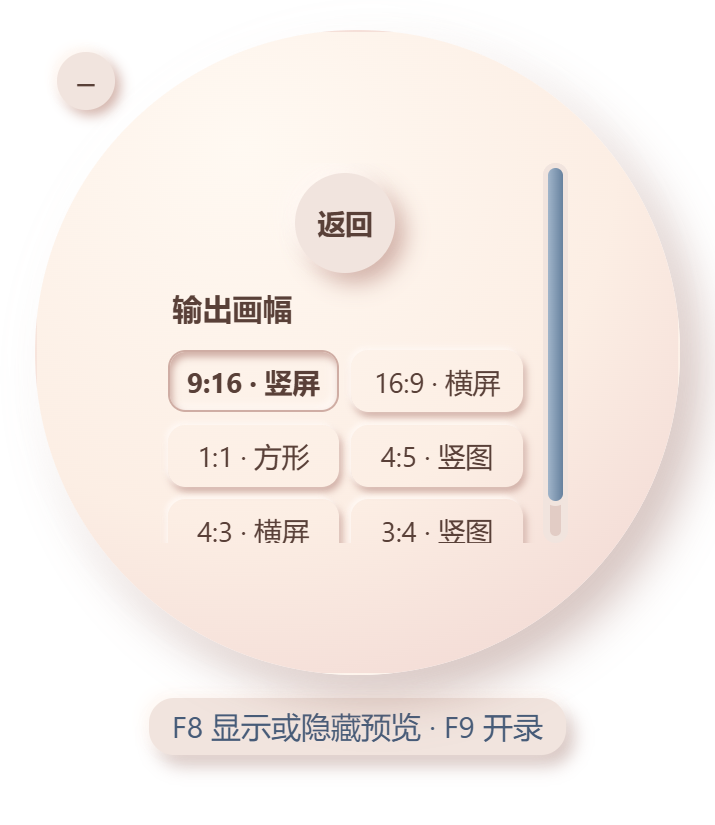

### 14. 录制电脑声音和麦克风

分别选择播放设备和麦克风，并通过实时电平确认信号。

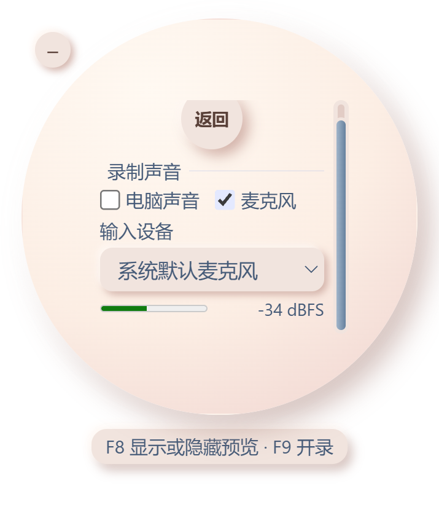

## 开始和结束录制

按圆盘中央按钮或 F9 开始和停止录制。F8 可隐藏或恢复实时预览。默认保存到「视频 / ScreenLive」。

## 从源码构建

在 Windows 上使用 Rust 和兼容的 Windows C/C++ 构建工具：

```powershell
cargo build --locked --release --manifest-path desktop-app/Cargo.toml
cargo build --locked --release --manifest-path platform/windows/Cargo.toml --example record
```

将生成的 `screenlive-desktop.exe` 改名为 `ScreenLive.exe`，将 `record.exe` 改名为 `record-backgrounds.exe`，并与 x64 的 `WebView2Loader.dll`、`ffmpeg.exe` 放在同一目录。加载器来自 [Microsoft WebView2 SDK](https://learn.microsoft.com/microsoft-edge/webview2/concepts/distribution#files-to-ship-with-the-app)。

- `desktop/` 控制圆盘和菜单
- `desktop-app/` Tauri 应用与设置
- `core/` 取景、镜头跟随和构图
- `platform/windows/` Windows 采集、预览和录制

## 许可证

自 v0.2.0 起，ScreenLive 仅允许非商业使用。商业使用须事先取得 HookyMaster 的书面授权。完整条款见 [LICENSE](LICENSE)。此前按 MIT 发布的 v0.1.0 仍适用 [当时的许可证](docs/LICENSE-v0.1.0-MIT.txt)。第三方组件各自适用原许可，见 [第三方组件说明](THIRD-PARTY-NOTICES.md)。
